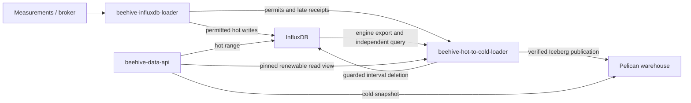

# Service architecture

[Documentation](README.md) · [Configuration](configuration.md) · [Developer guide](development.md)

## Responsibilities

The service archives one Influx bucket into the managed Iceberg table `sage.obs` on Pelican. It owns the archival scheduler, writer fences, late-data inbox, read grants, local SQL catalog, publication, verification, and guarded deletion. It does not serve measurement queries; `beehive-data-api` does that.

The Influx loader never writes the cold warehouse. It hands late measurements to this service durably. The API acquires a view containing coverage start, frontier, warehouse, exact Iceberg metadata, generation, and lease expiry. The frontier is an exclusive border: earlier covered data is cold; data from the border onward is hot. Requests before declared coverage are rejected.

## Archive lifecycle

Only complete UTC days ending at or before `now - hot retention` are eligible. The default is 720 hours (30 days), with up to another day of batching plus processing/backlog lag. Jobs advance oldest-first through durable stages.

| State | Work before advancing |
| --- | --- |
| `FENCING` | Wait for existing writer permits covering the day to release or expire plus drain grace. New writes to the fenced day become late receipts. |
| `EXPORTING` | Export the source engine into primitive local Parquet, retaining replay sequence. |
| `EXPORTED` | Normalize overwritten identities and prove equality against an independent Influx query. |
| `RECONCILED` | Materialize expected rows, pack the warehouse layout, and verify the build. |
| `BUILT` | Publish files and commit an Iceberg snapshot; recognize an already committed job on retry. |
| `COMMITTED` | Read back remote objects and perform fresh exact verification. |
| `REMOTE_VERIFIED` | Activate the snapshot and advance contiguous coverage atomically in the control journal. |
| `ROUTED` | For an archive job, wait for deletion enablement and old readers. Late jobs finish here without hot deletion. |
| `DELETING` | Reverify the published data on every destructive attempt, then request the hot interval deletion. |
| `DELETE_REQUESTED` | Query the interval to confirm it is empty; retry through `DELETING` if needed. |
| `COMPLETE` | Persist completion and clean eligible local scratch. |

A state names the next work to perform. Failed work remains recoverable; source mismatches can rewind to export, and stale normalized input can rewind to reconciliation. Capacity failures preserve reusable export work under its fence. `ROUTED` means cold data is queryable, not that the hot copy has been deleted.

The scheduler executes one worker step at a time. Native DuckDB work uses parallel threads within that step; the Go packer remains sequential. Existing jobs precede newly admitted work, with late work and eligible deletions considered before admitting another archive day. See [validation](validation.md) for accepted threading and canonical reuse policies.

## Late measurements

An edge device can replay old timestamps after reconnecting. The Influx loader acquires permits before hot writes and releases them after the write completes. Records targeting fenced/cold days are durably queued here before broker acknowledgement. Receipt IDs support retry without duplicating an accepted request.

A late job merges accepted records into the affected day's pinned cold snapshot and atomically replaces its files after verification. Matching identity is `(time, name, full tags)`; late corrections replace the value for that identity. Nanosecond instants and value kinds are retained. Older snapshots remain available to readers that already pinned them. Pending data before configured coverage requires an explicit backfill; it is not silently discarded.

## Warehouse layout

| Property | Current policy |
| --- | --- |
| Catalog | Local SQLite SQL catalog in `catalog.db`; remote objects on Pelican |
| Table | `sage.obs`, Iceberg format v3 |
| Partition | UTC `day(time)` |
| File membership | Chronological batches of at most 10,000,000 rows per day |
| Order inside a file | `plugin`, then `vsn`, then `time`, ascending with nulls last |
| Row groups | One plugin per group, capped at 262,144 rows; flush on plugin change |
| Compression | Parquet Zstandard level 3 |
| Layout marker | `bounded-plugin-v1` |

A large plugin occupies several row groups. Small plugins can share a file but have separate groups, which can be smaller than the cap. Sorting happens before packing groups. There is no requirement for one file or exactly one group per plugin. Iceberg's table sort order is recorded as unsorted; the physical layout is enforced by the worker/packer and validated using layout properties.

| Columns | Iceberg type |
| --- | --- |
| `time` (field ID 1) | Nanosecond timestamp with timezone |
| `name` | String |
| `plugin`, `vsn`, `node`, `host`, `task`, `job`, `zone` | Promoted string tags |
| `meta` (field ID 10) | Map of string to string for remaining tags |
| `value` (field ID 11) | VARIANT preserving float/int/bool/string, with marked decimal encoding for uint64 |

Local primitive staging is an internal representation with `time`, `name`, canonical `tags`, `kind`, textual `value`, and `seq`; it is not the published warehouse schema or an API response schema.

## Verification and persistence

Verification checks full records and duplicate multiplicity using bounded, partitioned comparisons in both directions. Hashes route work; hashes and row counts alone never prove equality. Object hashes and recorded scope bind the proofs to published artifacts. Build checks reuse canonical shards privately within a build; reconciliation, remote verification, and pre-delete verification retain fresh proofs. A failed or incomplete proof blocks progression.

`control.db` stores admission, read views, jobs, receipts, frontier, and durable outcome totals. `catalog.db` stores the Iceberg catalog for local operations, but user's can still hit Pelican directly to read our cold storage. Keep both and their associated files together through backup/recovery. One active coordinator owns   one state/catalog and warehouse; a process lock also survives in native children. There is no automatic remote object garbage collection or snapshot expiration.

Reader leases renew without changing their pinned snapshot/frontier. Unrenewed leases stop protecting deletion after expiry plus a one-minute grace. Writer permits also renew and expire; an expired writer stops blocking archival after a one-minute drain grace. Broker deliveries remain unacknowledged on lease loss and must be replayed under fresh admission. See [operations](operations.md) for the availability tradeoff and explicit stopped-writer recovery procedure.

## Canonical dictionaries

Tag canonicalization has one helper for the build, one for reconciliation, and one for remote verification. Each helper evaluates `IdentityTags()` once per distinct tag input and joins that result back onto every row. Time, name, kind, value, duplicate multiplicity, hash routing, and bidirectional `EXCEPT ALL` comparison still cover the full canonical record. `DuckDB.Equal` still applies the original `Canonical` SQL to both inputs when a proof needs an independent reference.

Build preparation lives in `internal/storage/typed_dictionary.go`. `PackExpected` calls it for each packed file. The file's promoted tag columns and complete `meta` map are the tag source. The dictionary keeps one copy of each tuple, runs `IdentityTags()` on that copy, and joins the canonical tags back with null-safe equality on every tuple column. The proof reads the columns that were packed. Each file receives a fresh exact proof, and those verified canonical shards then feed one new whole-build exact proof with the same SHA-256 bindings, shard inventory, and contiguous source-window checks. Shard reuse stays inside that build. `packing-profile.json` records `canonicalization: tag_dictionary`.

Reconciliation lives in `internal/storage/reconciliation.go`. `Worker.Reconcile` calls `DuckDB.EqualReconciliation` with the normalized engine export and the independently queried Influx primitive Parquet. Each input's raw tag strings are deduplicated before parsing. The original promoted-key and `meta` rules run once per distinct string, `IdentityTags()` serializes that result, and a null-safe join attaches the canonical tags to every row that carried the string. Stored JSON is parsed again on every call. Time and scalar conversion, nulls, and duplicate multiplicity follow the same rules as the original comparison. The two inputs must be distinct regular local Parquet files. Aliases, hard links, symlinks, and remote paths are rejected. The call rereads both files and rebuilds the dictionaries, counts, staging, refinement, and both directions of the exact proof. The worker uses sixteen fresh-comparison threads and the configured 3 GB native budget. The comparison profile records `canonicalization: raw_tag_dictionary`. This helper is the primitive reconciliation path. The typed build dictionary remains its own helper.

Remote and pre-delete verification use `DuckDB.EqualRemote` from `Worker.Verify` for `COMMITTED` and `DELETING`. The local expected Parquet uses the same typed tag and `meta` dictionary as build preparation. The scan of the published Iceberg objects keeps the original `Canonical` SQL. The expected input must be one regular local Parquet file. Symlinks, directories, and remote expected paths are rejected. Each proof rereads its inputs and rebuilds the local canonical rows. Counts, complete multiset equality, object hashes, metadata scope, and routing-hint order still bind the proof to the published objects. Manifests record `verification_canonicalization: local_dictionary`, and a successful `COMMITTED` or `DELETING` profile reports `local_dictionary`.

`Canonical` remains the SQL used by `Equal` and by the Iceberg side of remote and pre-delete proofs.

## Unsigned VARIANT convention

The managed table carries `sage.value.encoding=variant-uint64-decimal-v1`. That marker reserves `DECIMAL(20,0)` inside the `value` VARIANT for a source uint64. Float, signed integer, boolean, and string values keep their native representations. Parquet may widen the reserved decimal to `DECIMAL(38,0)`. Canonical comparisons accept both zero-scale forms, check that the number lies in `0..18446744073709551615`, and then record it as logical `UINT64`. The numeric JSON token stays an exact integer. A signed six and an unsigned six remain different proof records when their public JSON text is the same number.

Primitive staging keeps the source `kind` and the textual `value` together. Typed build materialization writes uint64 through the reserved decimal. Reconciliation, dictionary comparisons, packing proofs, remote verification, and pre-delete proofs all compare those logical source kinds. An encoding that fails the checks fails verification, and the hot interval stays in place. The published table still has one `value` column, and the public response adds no wrapper around it.

Startup and every commit require this property on the managed table. An older unmarked destination stays unmarked. Adopting the convention is a verified migration into a fresh managed prefix and state directory. An audited unmarked bootstrap source may contain native float, int, bool, and string values. A decimal in an unmarked source is rejected. A marked bootstrap source must declare `variant-uint64-decimal-v1`. An unsigned kind already dropped by native Parquet cannot be recovered from the remaining number. A native decimal is outside the five source kinds, and accepting one would take a new convention.
